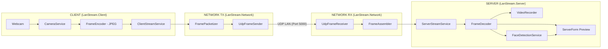

# KIẾN TRÚC HỆ THỐNG (ARCHITECTURE)

> Xem thêm bản thiết kế tổng thể đầy đủ tại [LAN_Video_Streaming_Architecture.md](LAN_Video_Streaming_Architecture.md).

## 1. Sơ đồ luồng truyền dữ liệu

## 2. Phân tách các Project & Quy tắc phụ thuộc

| Project             | Loại Project          | Phụ thuộc                            | Trách nhiệm chính                                    |
| ------------------- | --------------------- | ------------------------------------ | ---------------------------------------------------- |
| `LanStream.Shared`  | Class Library         | Không phụ thuộc project khác         | Models (`VideoFrame`, `StreamStatistics`) & Protocol |
| `LanStream.Network` | Class Library         | `LanStream.Shared`                   | Chia/ghép gói UDP, gửi/nhận UDP bất đồng bộ          |
| `LanStream.Client`  | Windows Forms (`exe`) | `LanStream.Network`, `Shared`        | Giao diện Client, đọc Webcam, nén JPEG               |
| `LanStream.Server`  | Windows Forms (`exe`) | `LanStream.Network`, `Shared`        | Giao diện Server, giải mã JPEG, ghi hình, nhận diện  |
| `LanStream.Tests`   | xUnit Test Project    | `LanStream.Network`, `Shared`        | Kiểm thử đơn vị cho Serializer, Packetizer, Assembler|

**Quy tắc bắt buộc:** `Client` và `Server` không tự cài đặt lại logic đóng gói hay ghép gói UDP; mọi thao tác mạng đi qua `LanStream.Network`.

## 3. Hợp đồng tích hợp nội bộ (Internal APIs)

| Lớp                    | Phương thức chính                                  | Đầu ra / Ý nghĩa                       |
| ---------------------- | -------------------------------------------------- | -------------------------------------- |
| `CameraService`        | `StartAsync(ct)`, `StopAsync()`                    | Luồng khung hình `Mat` từ Webcam       |
| `FrameEncoder`         | `EncodeJpeg(frame, quality)`                       | Mảng `byte[]` dữ liệu ảnh JPEG         |
| `FramePacketizer`      | `Packetize(jpegBytes, streamId, frameId, ts)`      | Danh sách datagram UDP (`byte[][]`)    |
| `UdpFrameSender`       | `SendFrameAsync(jpegBytes, streamId, frameId, ct)` | Gửi toàn bộ các chunk qua UDP          |
| `UdpFrameReceiver`     | `ReceiveLoopAsync(ct)`                             | Luồng gói UDP nhận được từ socket      |
| `FrameAssembler`       | `TryAddPacket(remoteEndPoint, datagram, out frame)`| Khung hình hoàn chỉnh `VideoFrame`     |
| `FrameDecoder`         | `DecodeToMat(jpegBytes)` / `DecodeToBitmap(...)`   | Ảnh hiển thị lên UI hoặc xử lý OpenCV  |
| `VideoRecorder`        | `Start(path, fps, size)`, `Write(frame)`, `Stop()` | Lưu file video `.mp4` / `.avi`         |
| `FaceDetectionService` | `DetectFaces(frame)`                               | Danh sách tọa độ khuôn mặt (`Rect[]`)  |
