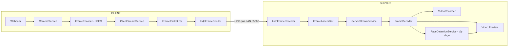

# THIẾT KẾ HỆ THỐNG – LAN VIDEO STREAMING

**Đề tài:** Xây dựng ứng dụng Stream Video qua mạng LAN  
**Đối tượng:** Nhóm 4 sinh viên (3 lập trình, 1 QA/tài liệu)  
**Nền tảng:** C# / .NET 10 / Windows Forms / VS Code / OpenCvSharp4 / UDP

## 1. Mục tiêu và phạm vi

### MVP bắt buộc
- Client lấy hình ảnh từ webcam, hiển thị preview, nén JPEG và gửi UDP.
- Server nhận UDP, ghép gói tin đúng khung hình, giải mã và hiển thị video.
- Xử lý gửi/nhận bất đồng bộ, Start/Stop ổn định, không làm treo UI.
- Chạy được trên 2 máy tính Windows cùng LAN hoặc trên một máy để kiểm thử loopback.

### Nâng cao
- Ghi video trên server (ưu tiên MP4; có thể dùng AVI/MJPG nếu thiếu codec).
- Hiển thị FPS, số frame nhận/mất và thống kê truyền dữ liệu.
- Phát hiện khuôn mặt bằng Haar Cascade hoặc YuNet; nhận diện danh tính là mức mở rộng khác, không đồng nghĩa với phát hiện khuôn mặt.
- Đọc video từ file thay webcam và hỗ trợ nhiều client nếu còn thời gian.

### Ngoài phạm vi MVP
- Stream qua Internet/NAT, âm thanh, đồng bộ audio-video, bảo mật như TLS/DTLS, truyền đáng tin cậy như TCP và codec H.264.

## 2. Kiến trúc tổng thể



**Quy định phụ thuộc:** Client và Server tham chiếu `Network` + `Shared`; `Network` tham chiếu `Shared`. `Shared` không phụ thuộc project khác. Socket và việc chia/ghép gói thuộc `Network`, không nằm trong WinForms.

## 3. Cấu trúc thư mục

```text
LANVideoStreaming/
├── LANVideoStreaming.sln
├── README.md
├── .gitignore
├── src/
│   ├── LanStream.Client/
│   │   ├── LanStream.Client.csproj
│   │   ├── Program.cs
│   │   ├── Forms/ClientForm.cs
│   │   ├── Services/CameraService.cs
│   │   ├── Services/FrameEncoder.cs
│   │   ├── Services/ClientStreamService.cs
│   │   └── Config/ClientSettings.cs
│   ├── LanStream.Server/
│   │   ├── LanStream.Server.csproj
│   │   ├── Program.cs
│   │   ├── Forms/ServerForm.cs
│   │   ├── Services/ServerStreamService.cs
│   │   ├── Services/FrameDecoder.cs
│   │   ├── Services/VideoRecorder.cs
│   │   ├── Services/FaceDetectionService.cs
│   │   └── Config/ServerSettings.cs
│   ├── LanStream.Network/
│   │   ├── LanStream.Network.csproj
│   │   ├── UdpFrameSender.cs
│   │   ├── UdpFrameReceiver.cs
│   │   ├── FramePacketizer.cs
│   │   └── FrameAssembler.cs
│   └── LanStream.Shared/
│       ├── LanStream.Shared.csproj
│       ├── Models/VideoFrame.cs
│       ├── Models/StreamStatistics.cs
│       └── Protocol/
│           ├── PacketHeader.cs
│           ├── PacketSerializer.cs
│           └── ProtocolConstants.cs
├── tests/LanStream.Tests/
│   ├── PacketTests.cs
│   ├── FrameAssemblerTests.cs
│   └── NetworkTests.cs
├── docs/
│   ├── REQUIREMENTS.md
│   ├── ARCHITECTURE.md
│   ├── UDP_PROTOCOL.md
│   ├── TEST_PLAN.md
│   └── USER_GUIDE.md
├── assets/models/
└── recordings/
```

`bin/`, `obj/`, `.vs/`, `.vscode` (trừ cấu hình được chia sẻ có chủ đích), `recordings/*.mp4`, `recordings/*.avi` phải được bỏ qua trong `.gitignore`.

## 4. Luồng xử lý chính

### Client
1. Người dùng mở Client, nhập IP server và port, chọn camera.
2. Start: khởi tạo `VideoCapture`, đưa các frame vào vòng lặp bắt hình có hỗ trợ hủy.
3. Resize về 640x480, giới hạn ~15 FPS và nén JPEG (quality 60–70).
4. `FramePacketizer` chia JPEG thành chunk; `UdpFrameSender` gửi bất đồng bộ.
5. Stop: hủy `CancellationToken`, đợi tác vụ dừng, giải phóng camera/socket.

### Server
1. Start: bind UDP port 5000 trên máy server.
2. `UdpFrameReceiver` nhận datagram bất đồng bộ và kiểm tra header.
3. `FrameAssembler` gom chunk theo địa chỉ nguồn + StreamId + FrameId, xử lý chunk trùng/sai thứ tự.
4. Chỉ phát frame khi nhận đủ chunk; frame quá hạn thì bỏ.
5. `FrameDecoder` giải mã JPEG thành hình; UI hiển thị bằng `BeginInvoke`/`InvokeAsync` theo phiên bản .NET được dùng.
6. Nếu bật Record, ghi frame bằng `VideoWriter`; nếu bật Face Detection, xử lý trong nhánh nền, không chặn nhận UDP.

**Tách luồng:** Capture/Encode, Network Receive/Assemble, Decode/UI, Record/Detection không chạy trên thread UI. Dùng bounded Channel/queue, bỏ frame cũ khi quá tải để giữ độ trễ thấp.

## 5. Giao thức UDP phiên bản 1 (đề xuất)

- Mỗi UDP datagram tối đa 1.200 byte (đây là kích thước datagram ứng dụng, không phải 1.200 byte chỉ dành cho JPEG).
- Header cố định 24 byte; phần JPEG tối đa 1.176 byte/gói.
- Gửi **unicast** từ Client đến IP:5000 của Server.
- Header dùng **network byte order (big-endian)**.

| Offset | Số byte | Trường | Kiểu / ý nghĩa |
|---:|---:|---|---|
| 0 | 2 | Magic | `0x4C56` (`LV`) |
| 2 | 1 | Version | `1` |
| 3 | 1 | Flags | `0` cho DATA ở MVP |
| 4 | 4 | StreamId | ID luồng do client tạo khi Start |
| 8 | 4 | FrameId | ID frame tăng dần |
| 12 | 2 | ChunkIndex | 0 đến ChunkCount-1 |
| 14 | 2 | ChunkCount | Tổng số chunk của frame |
| 16 | 8 | TimestampMs | Unix time milliseconds client gửi |
| 24+ | <=1176 | Payload | Một phần JPEG |

Độ dài payload = `datagram.Length - 24`. Không phải truyền thêm `PayloadLength` nếu dùng định dạng này.

**Kiểm tra dữ liệu:** Magic đúng, Version hỗ trợ, độ dài header >=24, ChunkCount từ 1 đến 256, ChunkIndex < ChunkCount, số byte JPEG sau ghép <=256KiB, giới hạn số frame đệm mỗi client. Không chấp nhận các gói không hợp lệ. Key frame lắp ghép: `(RemoteEndPoint, StreamId, FrameId)`.

**Chính sách mất gói:** UDP không đảm bảo thứ tự hay giao hàng. Chấp nhận gói không đúng thứ tự, bỏ gói trùng, bỏ frame khi quá 200ms mà vẫn thiếu chunk; không tự retransmit trong MVP. Giải phóng các buffer quá hạn. Ưu tiên frame mới hơn frame cũ.

**Trạng thái kết nối:** UDP không thiết lập kết nối như TCP. Giao diện chỉ báo "Đang nhận video" nếu nhận được frame hợp lệ trong vài giây gần nhất; báo "Không nhận tín hiệu" khi ngừng nhận. Không nên hiện "TCP Connected" hoặc giả định mọi frame đều tới.

## 6. Giao diện ứng dụng

### ClientForm
```text
+------------------- LAN VIDEO CLIENT ------------------+
| Server IP: [192.168.1.20]   Port: [5000]             |
| Camera: [Webcam 0   v]     Chất lượng: [60 v]         |
|                                                        |
|                LIVE CAMERA PREVIEW                     |
|                                                        |
| [Start Camera]  [Start Stream]  [Stop Stream]          |
| Trạng thái: Đang gửi | FPS: 15 | Kích thước: 640x480 |
+--------------------------------------------------------+
```

### ServerForm
```text
+------------------- LAN VIDEO SERVER ------------------+
| Listening Port: [5000]  [Start Server] [Stop Server]  |
|                                                        |
|                   RECEIVED VIDEO                       |
|                                                        |
| Source: 192.168.1.21:xxxxx | FPS: 14 | Missing: 3    |
| [Start Recording] [Stop Recording] [Face Detection]   |
| File: recordings/2026-11-02_0814.mp4                 |
+--------------------------------------------------------+
```

- Trên WinForms không thao tác `PictureBox.Image` trực tiếp từ background task.
- Giải phóng hình cũ khi cập nhật preview (`Bitmap.Dispose`) và giải phóng `Mat`, `VideoCapture`, `VideoWriter`.
- Mở cửa sổ ở kích thước vừa phải, có thể kéo giãn và chọn camera/port.

## 7. API nội bộ đề xuất (hợp đồng tích hợp)

| Lớp | API quan trọng | Kết quả |
|---|---|---|
| `CameraService` | `StartAsync(ct)`, `StopAsync()` | Cung cấp frame từ webcam |
| `FrameEncoder` | `EncodeJpeg(frame, quality)` | `byte[]` JPEG |
| `FramePacketizer` | `Packetize(jpeg, streamId, frameId)` | `IEnumerable<byte[]>` datagram |
| `UdpFrameSender` | `SendFrameAsync(jpeg, endpoint, ct)` | Gửi từng chunk UDP |
| `UdpFrameReceiver` | `ReceiveLoopAsync(ct)` | Datagrams từ socket |
| `FrameAssembler` | `TryAddPacket(endpoint, packet, out jpeg)` | Hoàn thành một frame JPEG |
| `FrameDecoder` | `Decode(jpeg)` | Hình/frame để hiển thị |
| `VideoRecorder` | `Start(path, fps, size)`, `Write(frame)`, `Stop()` | Video lưu trên máy |
| `FaceDetectionService` | `Detect(frame)` | Danh sách hộp khuôn mặt |

Tên API là **gợi ý hợp đồng**, các thành viên chốt chính xác tham số/kiểu trả về ở ngày đầu và không tự ý thay đổi khi đang tích hợp.

## 8. Thông số mặc định cho MVP

| Thông số | Giá trị khởi đầu |
|---|---|
| Nguồn video | Webcam 0 |
| Kích thước | 640 × 480 |
| FPS giới hạn | 15 |
| JPEG Quality | 60 |
| UDP Port | 5000 |
| UDP Datagram | <=1.200 bytes |
| Timeout frame chưa đủ gói | 200ms |
| Số client | 1 |
| Số frame chờ decode | 1–2 frame (bounded) |
| Format ghi hình | MP4 nếu codec hỗ trợ; dự phòng AVI/MJPG |

Đây là thông số khởi điểm, điều chỉnh theo FPS/băng thông/độ trễ đo thực tế. Video ghi nên dùng FPS mục tiêu hoặc FPS đã ổn định; video đầu ra cần xử lý khi nguồn frame có tốc độ không đều.

## 9. Phân việc

| Người | Phần code/tài liệu phụ trách | Deliverable |
|---|---|---|
| TV1 – Nhóm trưởng | ServerForm, ServerStreamService, FrameDecoder, VideoRecorder, tích hợp | Server nhận & hiện video, ghi hình |
| TV2 | ClientForm, CameraService, FrameEncoder, ClientStreamService | Client preview & gửi frame JPEG |
| TV3 | PacketHeader/Serializer, UDP sender/receiver, Packetizer/Assembler, network tests | Thư viện UDP hoạt động độc lập |
| TV4 – QA/Docs | SRS, kiến trúc/Use Case, Figma mockup, Test Plan, hướng dẫn cài đặt, báo cáo, slide, video demo | Bộ tài liệu và bằng chứng kiểm thử |

TV1 và TV3 thống nhất `Shared/Protocol`. TV4 **không bắt buộc lập trình** nhưng chịu trách nhiệm thiết kế test case, thu thập số liệu và theo dõi lỗi, không chỉ làm slide.

## 10. Kế hoạch theo mốc

| Mốc | Kết quả phải có |
|---|---|
| Ngày 1–2 | Repo + solution compile, giao thức chốt, 2 wireframes, yêu cầu chức năng |
| Ngày 3–4 | Client webcam preview + Server skeleton + Unit Test Packetizer |
| Ngày 5–7 | Gửi JPEG qua UDP trên localhost, ghép đúng frame và hiển thị |
| Ngày 8–9 | Chạy thực tế qua 2 máy LAN; xử lý Stop/Start và frame mất |
| Ngày 10–11 | Ghi video, thống kê FPS; cân nhắc Face Detection |
| Ngày 12–14 | Thử lỗi thực tế, tối ưu, viết báo cáo/slide và quay demo |

**Thứ tự ưu tiên:** Có video LAN hoạt động trước, rồi mới thêm ghi hình và khuôn mặt.

## 11. Test cases tối thiểu

| ID | Bài test | Kết quả mong đợi |
|---|---|---|
| TC01 | Client Start Camera | Camera preview bình thường |
| TC02 | Server Start port 5000 | Bắt đầu lắng nghe, không treo UI |
| TC03 | Client gửi vào localhost | Server hiển thị video |
| TC04 | Client gửi đến IP LAN server | Server hiển thị video trên máy khác |
| TC05 | Nhập IP/Port sai | UI báo lỗi/thông báo không có tín hiệu |
| TC06 | Stop Stream rồi Start lại | Không giữ socket/camera cũ |
| TC07 | Gói đến sai thứ tự | Frame vẫn ghép đúng nếu đủ gói |
| TC08 | Thiếu một chunk | Bỏ frame quá hạn, không treo |
| TC09 | Gói hỏng hoặc không đúng version | Bỏ gói, app không crash |
| TC10 | Start/Stop Recording | File mở được bằng media player |
| TC11 | Rút webcam khi đang stream | Báo lỗi và dọn tài nguyên |
| TC12 | Windows Firewall chặn cổng | Hướng dẫn mở UDP 5000 và thử lại |
| TC13 | Truyền 5 phút liên tục | Không tăng bộ nhớ vô hạn, không crash |
| TC14 | Bật nhận diện khuôn mặt | Có hộp mặt nếu detection hoạt động |

**Chỉ số cần ghi lại:** FPS nhận, FPS gửi, bitrate ước lượng, số frame hoàn chỉnh, số frame bị bỏ, mức CPU/RAM; độ trễ một chiều chỉ tin cậy khi đồng bộ thời gian hai máy, hoặc có giao thức đo RTT riêng.

## 12. Khởi tạo solution từ CLI (Windows)

```powershell
mkdir LANVideoStreaming
cd LANVideoStreaming
dotnet new sln -n LANVideoStreaming --format sln

dotnet new classlib -n LanStream.Shared -o src/LanStream.Shared
dotnet new classlib -n LanStream.Network -o src/LanStream.Network
dotnet new winforms -n LanStream.Client -o src/LanStream.Client --framework net10.0
dotnet new winforms -n LanStream.Server -o src/LanStream.Server --framework net10.0
dotnet new xunit -n LanStream.Tests -o tests/LanStream.Tests

dotnet sln add src/LanStream.Shared/LanStream.Shared.csproj
dotnet sln add src/LanStream.Network/LanStream.Network.csproj
dotnet sln add src/LanStream.Client/LanStream.Client.csproj
dotnet sln add src/LanStream.Server/LanStream.Server.csproj
dotnet sln add tests/LanStream.Tests/LanStream.Tests.csproj

dotnet add src/LanStream.Network/LanStream.Network.csproj reference src/LanStream.Shared/LanStream.Shared.csproj
dotnet add src/LanStream.Client/LanStream.Client.csproj reference src/LanStream.Network/LanStream.Network.csproj src/LanStream.Shared/LanStream.Shared.csproj
dotnet add src/LanStream.Server/LanStream.Server.csproj reference src/LanStream.Network/LanStream.Network.csproj src/LanStream.Shared/LanStream.Shared.csproj
dotnet add tests/LanStream.Tests/LanStream.Tests.csproj reference src/LanStream.Network/LanStream.Network.csproj src/LanStream.Shared/LanStream.Shared.csproj

dotnet add src/LanStream.Client/LanStream.Client.csproj package OpenCvSharp4.Windows
dotnet add src/LanStream.Server/LanStream.Server.csproj package OpenCvSharp4.Windows

dotnet restore
dotnet build
```

Trên .NET SDK 10, `dotnet new sln` mặc định tạo `.slnx`. Ở ví dụ trên, `--format sln` được dùng để tạo đúng file `.sln` như cây thư mục. Nếu nhóm chọn `.slnx`, chỉ cần nhất quán tên solution trong tài liệu và lệnh CLI.

**Chạy:**
```powershell
dotnet run --project src/LanStream.Server
dotnet run --project src/LanStream.Client
```

Trên hai máy Windows trong LAN, chạy Server trước. Lấy địa chỉ IPv4 của Server bằng `ipconfig`. Client nhập IPv4 Server và port 5000. Cho phép UDP 5000 trong Windows Firewall (mạng Private) khi được hỏi. Không mở port ra Internet.

## 13. Quy tắc làm nhóm

- 1 nhánh Git/đầu việc; Pull Request trước khi merge `main`.
- Không sửa trực tiếp source thuộc module của thành viên khác, trừ khi đã thống nhất.
- Thống nhất version package/SDK, format UDP header, và model `VideoFrame` ngay đầu dự án.
- Mỗi thay đổi protocol phải cập nhật `docs/UDP_PROTOCOL.md` + unit test.
- Không commit video quay thật, ảnh mặt người, file ghi hình hoặc dữ liệu cá nhân lên repo công khai.

## 14. Tiêu chí nghiệm thu

MVP được coi là đạt khi Server và Client chạy trên hai máy tính Windows trong cùng LAN; Client webcam gửi UDP; Server hiển thị video tương đối liên tục; UI không treo khi truyền/Stop/Start; thiếu gói không gây crash hoặc bộ nhớ tăng vô hạn; nhóm có test case, ảnh chụp và video demo làm bằng chứng.
